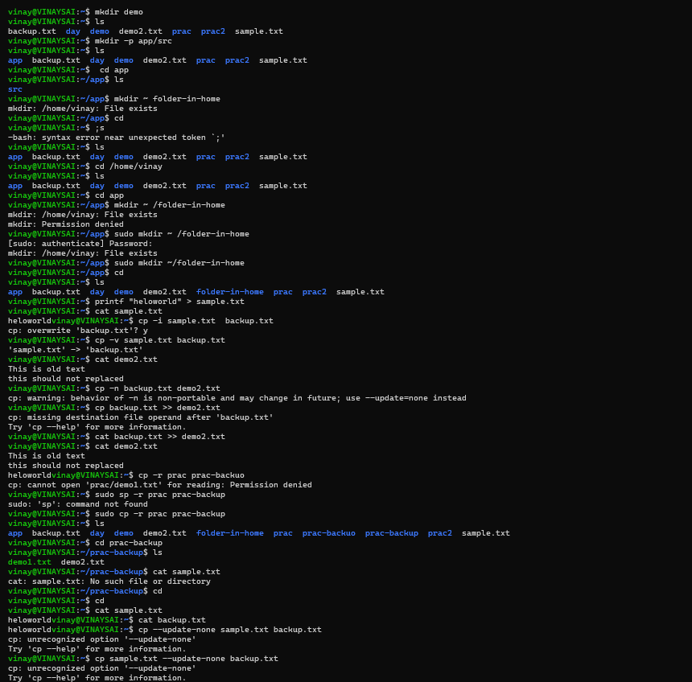
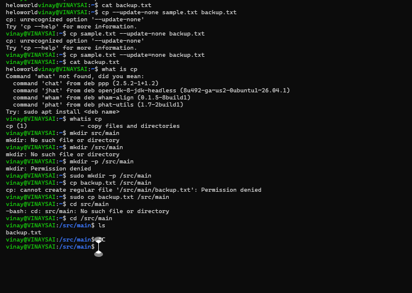

 1. mkdir -p app/src
 2. sudo mkdir ~/folder-in-home
 3. printf "heloworld" > sample.txt
 4. cp -i sample.txt  backup.txt
 5. cp -v sample.txt backup.txt
 6. cat backup.txt >> demo2.txt
 7. cp sample.txt --update=none backup.txt
 8. sudo cp backup.txt /src/main
 9. sudo cp -r prac prac-backup
 10. whatis cp
 
