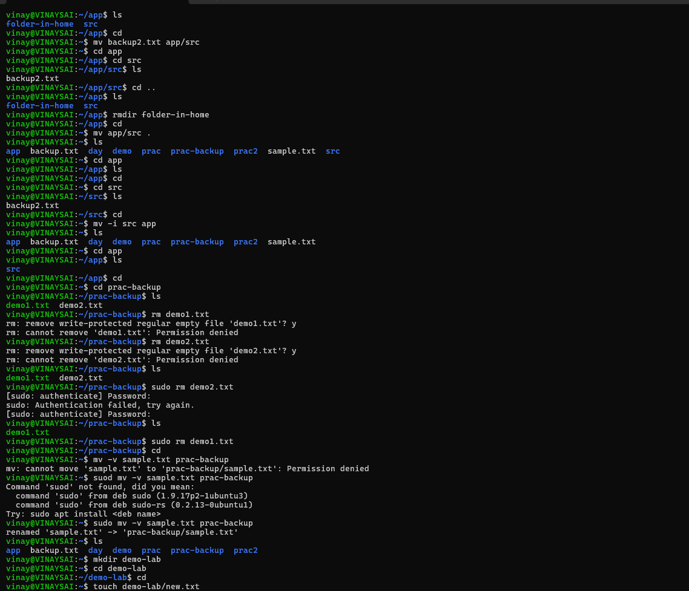
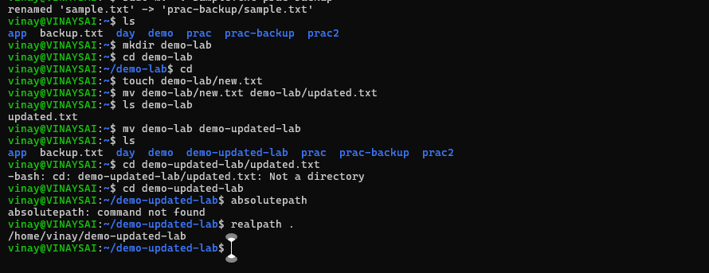

1. mv demo2.txt  backup2.txt
2. mv backup2.txt app/src
3. mv app/src .
4. mv -i src app
5. sudo mv -v sample.txt prac-backup
6. mkdir demo-lab
7. touch demo-lab/new.txt
8.  mv demo-lab/new.txt demo-lab/updated.txt
9. mv demo-lab demo-updated-lab
10. realpath .

